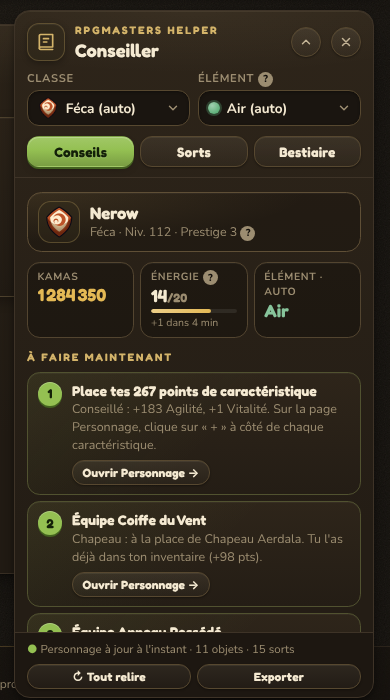
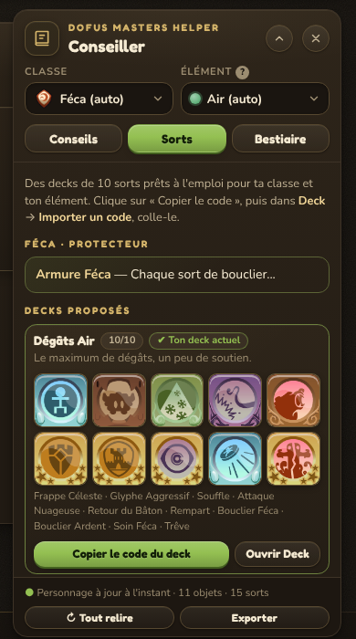
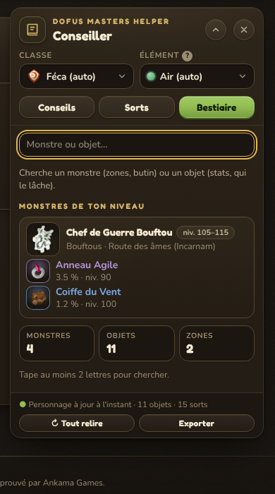

# RpgMasters Helper

Extension de navigateur non officielle pour **[RpgMasters](https://rpgmasters.houk.fr/)**.
Elle ajoute au site un panneau « Conseiller » qui aide les joueurs, et en particulier les
débutants, à progresser : où placer leurs points de caractéristique, quels objets de leur
inventaire équiper, quels decks de sorts utiliser et quels monstres combattre.

Toutes les informations viennent **du jeu lui-même**, relues automatiquement : si une valeur
change côté serveur, l'extension s'aligne sans mise à jour de son code. Elle ne fait que
**lire** les pages du jeu ; elle ne déclenche aucune action à la place du joueur.

| Conseils | Sorts | Bestiaire |
| :---: | :---: | :---: |
|  |  |  |

<sub>Captures réalisées sur une copie de la page du site, avec des données d'exemple.</sub>

---

## Sommaire

- [Fonctionnalités](#fonctionnalités)
- [Principes](#principes)
- [Installation](#installation)
- [Utilisation](#utilisation)
- [Fonctionnement technique](#fonctionnement-technique)
- [Dépendances vis-à-vis du site](#dépendances-vis-à-vis-du-site)
- [Confidentialité et sécurité](#confidentialité-et-sécurité)
- [Structure du projet](#structure-du-projet)
- [Développement](#développement)
- [Limites connues](#limites-connues)
- [Pistes pour le site](#pistes-pour-le-site)
- [Mentions](#mentions)

---

## Fonctionnalités

### Conseils
- **À faire maintenant** : une liste d'actions concrètes et ordonnées (placer ses points,
  équiper un meilleur objet, mettre le deck conseillé, combattre les Recherchés et Archimages
  de la Chasse ou avancer dans l'Aventure), chacune avec un lien vers la page du jeu concernée.
  Les étapes **se cochent d'elles-mêmes** une fois réalisées ; celles qui ne peuvent pas être
  détectées (les combats) se cochent à la main, pour la journée.
- **Carte du personnage** : nom, classe, niveau, prestige, kamas et énergie (avec le temps
  restant avant le prochain point), plus l'élément du build, déduit de l'équipement porté.
  Classe et élément restent modifiables.
- **Points de caractéristique**, selon quatre stratégies au choix :
  - *Recommandé* : chaque point est placé là où il rapporte le plus, en tenant compte des
    **paliers de coût réels** du jeu (la stat de l'élément tant qu'elle est bon marché, puis la
    Vitalité) ;
  - *Tout dans l'élément*, *Tout en Vitalité* ;
  - *Libre* : le joueur répartit lui-même, l'extension calcule le gain exact et les points restants.
- **Équipement à changer** : uniquement les objets **déjà présents dans l'inventaire** qui
  surpassent ceux portés, emplacement par emplacement, avec le gain estimé.

### Sorts
- Passif de la classe et sorts les plus rentables (dégâts moyens par PA) dans l'élément choisi.
- **Trois decks** (Dégâts, Équilibré, Survie) composés uniquement de sorts que le personnage
  peut réellement utiliser, à la taille de deck du jeu, avec les icônes du jeu. Le deck déjà
  équipé est signalé.
- Bouton **« Copier le code du deck »** : génère un code au format officiel `DM-S-…`, à coller
  dans *Deck → Importer un code*. C'est le jeu qui valide et applique le deck.

### Bestiaire
- Monstres adaptés au niveau du joueur, avec zones et butin (taux de drop).
- Recherche par nom de monstre (niveaux, race, zones, butin) ou d'objet (stats, monstres qui le lâchent).

### Interface
- Design aligné sur celui du site : couleurs, polices, composants (boutons, puces, tuiles,
  cadres de rareté), via les variables CSS du site.
- Panneau **déplaçable** (position mémorisée), **repliable** et refermable, avec un bouton
  flottant pour le rouvrir. Il évite la barre d'annonces et le bouton « Chat ».
- Message d'accueil à la première ouverture et aides contextuelles « ? ».
- Utilisable au clavier et sur mobile.

---

## Principes

1. **Lecture seule.** L'extension lit les pages que le joueur peut déjà consulter. Elle ne
   clique sur rien, n'envoie aucune action de jeu et ne contourne aucune règle (par exemple,
   elle ne permet pas de changer d'équipement en combat).
2. **Aucune donnée en dur.** Objets, monstres, sorts, classes, coûts des caractéristiques :
   tout est lu sur le site. Seule la *façon d'interpréter* ces données (poids des stats,
   composition des decks) est propre à l'extension.
3. **Sobriété envers le serveur.** Les données sont mises en cache localement et rafraîchies
   rarement (voir [Fonctionnement technique](#fonctionnement-technique)).
4. **Aucune donnée ne quitte le navigateur du joueur.**

---

## Installation

L'extension n'est pas publiée sur un store ; elle s'installe en mode développeur.

**Chrome, Edge, Brave, Opera (Chromium)**
1. Récupérer le projet (*Code → Download ZIP*, puis décompresser) ou le cloner.
2. Ouvrir `chrome://extensions` (ou `edge://extensions`).
3. Activer le **Mode développeur**.
4. Cliquer sur **Charger l'extension non empaquetée** et choisir le dossier contenant `manifest.json`.
5. Se rendre sur https://rpgmasters.houk.fr/ et se connecter.

Après une mise à jour des fichiers : bouton ↻ sur la carte de l'extension, puis rechargement de la page du jeu.

> Firefox n'est pas encore pris en charge (le manifeste utilise un *service worker* MV3 propre à Chromium).

---

## Utilisation

| Action | Comment |
| --- | --- |
| Afficher / masquer | Icône de l'extension dans la barre d'outils, bouton ×, ou bouton rond en bas à droite |
| Replier | Bouton ⌃ dans le titre du panneau |
| Déplacer | Tirer le titre du panneau ; double-clic pour revenir à la position d'origine |
| Mise à jour des données | Automatique ; bouton **↻ Tout relire** pour forcer la relecture complète |
| Importer un deck | **Copier le code du deck**, puis *Deck → Importer un code* dans le jeu |

---

## Fonctionnement technique

### Lecture des données

Le site est une application Next.js (App Router). À chaque page, le serveur intègre les données
des composants dans le HTML, sous forme de fragments `self.__next_f.push([1, "…"])` (format
« Flight » de React Server Components). L'extension :

1. télécharge la page avec la session du joueur (`fetch` même origine, cookies inclus) ;
2. reconstitue le flux Flight et décode les lignes `id:JSON` ;
3. repère les enregistrements par leur forme : un objet avec un nom `n` et un niveau `lvl`,
   une fourchette `lo`/`hi` ou une classe `cls`.

### Pages consultées et fréquence

| Page | Données extraites | Rafraîchissement |
| --- | --- | --- |
| `/bestiaire` | monstres, zones, butin | au plus 1 fois / 24 h |
| `/bestiaire?onglet=objets&n=5000` | objets et statistiques | au plus 1 fois / 24 h |
| `/collection?onglet=objets&n=5000` | objets, possession | au plus 1 fois / 24 h |
| `/collection?onglet=sorts` | sorts | au plus 1 fois / 24 h |
| `/personnage` | nom, niveau, prestige, kamas, énergie, classe, équipement, inventaire, caractéristiques, points libres | après une action du joueur (voir ci-dessous) |
| `/deck` | sorts utilisables, deck actif, taille d'un deck, classe | avec `/personnage` |

Le **catalogue** (quatre premières lignes) n'est relu qu'au chargement d'une page du jeu, s'il
a plus de 24 heures, ou à la demande (bouton « Tout relire »).

La **fiche du personnage** (`/personnage` et `/deck`, soit deux requêtes) est relue pour que
les conseils suivent ce que fait le joueur :

- quand il change de page sur le site ;
- quand il revient sur l'onglet ;
- après un clic sur un bouton des pages Personnage, Deck ou Inventaire ;
- au chargement d'une page, si la dernière lecture date de plus de 10 minutes.

Ces relectures n'ont lieu que si l'onglet est visible, au plus **une fois toutes les 3 secondes**,
avec `cache: "no-store"` pour obtenir l'état actuel. Toutes les requêtes sont séquentielles. Si
une page échoue, les autres sont conservées et l'erreur est signalée dans le panneau.

### Calculs

- **Coût des points** : simulation point par point à partir des paliers `tiers` fournis par le jeu.
- **Note d'un objet** : somme pondérée de ses stats pour l'élément choisi (poids dans
  `WEIGHTS`, `src/advisor.js` ; par exemple 1 PA ≈ 100 points de stat principale). C'est une
  estimation, ajustable.
- **Decks** : sorts utilisables par le personnage (liste fournie par la page Deck), classés par
  dégâts moyens par PA dans l'élément, complétés par des sorts de soutien selon le style du
  deck. Un deck est considéré comme équipé si le deck actif contient tous ses sorts.
- **Étapes faites** : une étape qui disparaît après une relecture de la fiche (points placés,
  objet équipé, deck en place) est affichée comme faite jusqu'au rechargement de la page.
- **Code de deck** : même encodage que le bouton « Code du deck » du site (version `2`, classe,
  nombre de cartes et identifiants en entiers variables, base 32, contrôle FNV-1a). Il a été
  vérifié comme identique à l'encodeur du site, cas limites compris.

---

## Dépendances vis-à-vis du site

L'extension s'appuie sur des éléments du site susceptibles d'évoluer. Si l'un d'eux change,
la fonctionnalité correspondante cesse de fonctionner, sans gêner le jeu lui-même.

| Élément du site | Utilisé pour |
| --- | --- |
| Flux `self.__next_f` intégré au HTML | Toutes les données |
| Champs abrégés `n`, `lvl`, `s`, `r`, `icon`, `st`, `setName`, `w` (objets) | Objets et équipement |
| Champs `monsters` (`gfx`, `race`, `lo`, `hi`, `z`, `d`) et `zones` | Bestiaire |
| Champs `card` / `cards` (`ap`, `eff`, `cls`, `lvl`, `icon`) | Sorts et decks |
| Props du menu profil (`name`, `level`, `kamas`, `energy` : `value`, `max`, `nextAt`, `periodSec`) | Nom, niveau, kamas, énergie |
| Props du composant Deck (`collection` `{ key, card }`, `initialDecks`, `initialActive`, `breedId`, `deckSize`) | Sorts utilisables, deck actif, classe, taille des decks |
| Bloc `{ classes, current }` de `/personnage` | Classe actuelle (si la page Deck est illisible) |
| Champs `slots`, `inventory`, `rows` (`base`, `tiers`), `pointsFree`, `prestige` | Fiche personnage |
| Paramètre `n` des listes d'objets | Lecture du catalogue complet |
| Chemins `/personnage`, `/deck`, `/inventaire`, `/chasse`, `/aventure` | Liens et détection des actions du joueur |
| Format des codes de deck `DM-S-…` | Bouton de copie du deck |
| Images `/img/items/`, `/img/spells/sort_`, `/img/monsters/`, `/img/breeds/` | Icônes |
| Variables CSS `--color-*`, `--font-*`, `--dm-*` | Apparence (valeurs de secours intégrées) |
| Page « Ma collection » (libellé « Équipables par moi (niv. N…) », cartes d'objets) | Lecture de secours du niveau et des objets possédés |

---

## Confidentialité et sécurité

- **Permissions minimales** : `storage` uniquement. Le script ne s'exécute que sur
  `https://rpgmasters.houk.fr/*`.
- **Aucun serveur tiers** : aucune requête n'est envoyée ailleurs que vers le site du jeu ;
  aucune statistique d'usage n'est collectée.
- **Aucun identifiant manipulé** : l'extension n'accède ni aux cookies ni aux jetons de
  session ; les requêtes utilisent la session du navigateur comme une navigation normale.
- **Stockage local** (`chrome.storage.local`) : catalogue du jeu, fiche du personnage et
  préférences d'affichage, effaçables en désinstallant l'extension.
- Le bouton **Exporter** (pied du panneau) produit un échantillon de la structure des données,
  utile au diagnostic. Il n'est envoyé nulle part : le joueur choisit de le copier ou non.

---

## Structure du projet

```
manifest.json          Déclaration de l'extension (Manifest V3)
src/game.js            Lecture des pages : flux Next.js, page « Ma collection », code de deck
src/catalog.js         Synchronisation et cache des données du jeu
src/advisor.js         Calculs : points, équipement, sorts et decks
src/dropdown.js        Menus déroulants accessibles
src/overlay.js         Panneau : rendu, onglets, interactions
src/overlay.css        Styles du panneau (variables CSS du site)
src/background.js      Clic sur l'icône de l'extension
icons/                 Icônes de l'extension
docs/images/           Captures d'écran
```

Le code est en JavaScript sans dépendance ni étape de compilation : les fichiers du dépôt sont
exactement ceux chargés par le navigateur.

---

## Développement

1. Charger le dossier comme extension non empaquetée (voir [Installation](#installation)).
2. Modifier les fichiers, puis ↻ sur la carte de l'extension et recharger la page du jeu.
3. Les erreurs d'affichage sont signalées dans le panneau et détaillées dans la console de la
   page (préfixe `[RpgMasters Helper]`).

Pendant le développement, l'extension a été testée avec Playwright et Chromium sur des copies
des pages du site (HTML, feuilles de style, polices et images réels) et des données au format
du jeu. Ces tests ont couvert le décodage des données, les calculs de points, l'équipement,
l'encodage des codes de deck (comparé à celui du site), l'interface et la mémorisation de la position.

---

## Limites connues

- La **note des objets** et la **composition des decks** reposent sur des heuristiques ; elles
  ne remplacent pas la connaissance fine du jeu.
- Le format du code de deck est repris du site à la date d'écriture.
- Les combats (Chasse, Aventure) ne sont pas détectés : l'étape se coche à la main.
- Certaines mécaniques ne sont pas modélisées : bonus de panoplie, prestige dans les calculs,
  plafonds de PA.
- Une modification de la structure des données du site peut nécessiter une adaptation
  (voir [Dépendances](#dépendances-vis-à-vis-du-site)).

---

## Pistes pour le site

Si l'équipe du jeu souhaite faciliter ce type d'outil, ou en intégrer les idées directement :

- **Une API JSON publique et versionnée** (`/api/items`, `/api/monsters`, `/api/spells`) rendrait
  l'extension plus robuste et moins coûteuse que la lecture des pages.
- **Des attributs stables** (`data-*`) sur les éléments clés (niveau, classe) éviteraient de
  dépendre de la structure interne.
- Les fonctionnalités **« À faire maintenant »**, **« Équipement à changer »** et
  **decks recommandés** pourraient être intégrées nativement au jeu, notamment pour les
  nouveaux joueurs.

---

## Mentions

Projet de fan, **non officiel**, gratuit et sans but lucratif. Il n'est ni affilié, ni soutenu,
ni approuvé par Ankama Games ni par l'équipe de RpgMasters. Les noms, images et contenus de
l'univers DOFUS appartiennent à Ankama Games. L'extension n'embarque aucune image du jeu :
elle les charge depuis le site. Les captures du dossier `docs/images` en montrent à titre
d'illustration.

Licence : à définir avec le propriétaire du jeu.
